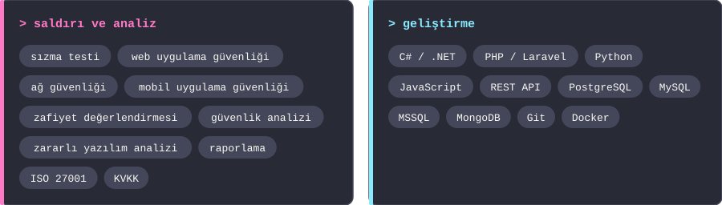
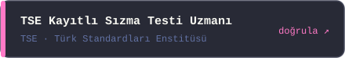
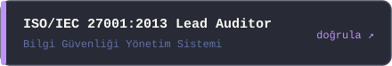
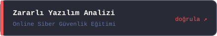
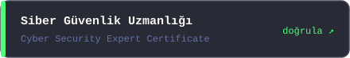
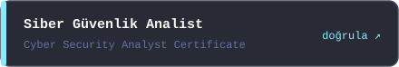
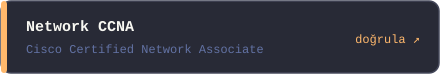
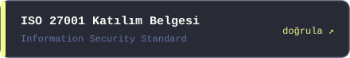
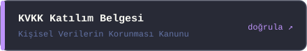

Siber güvenlik analiz uzmanı ve yazılım geliştiricisiyim. Isparta Üniversitesi mezunuyum; bilgi güvenliği ve siber güvenlik alanında çalışıyorum. Web, ağ ve mobil uygulama güvenliği alanlarında sızma testi, zafiyet analizi ve raporlama yapıyor, güvenli dijital çözümler geliştiriyorum.

<picture>
  
</picture>

